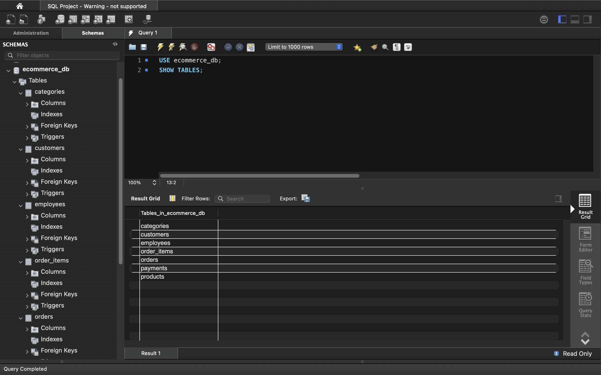
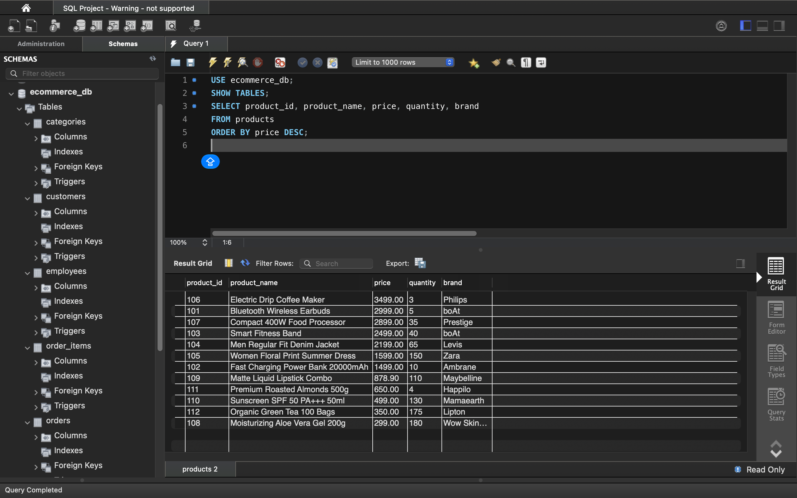
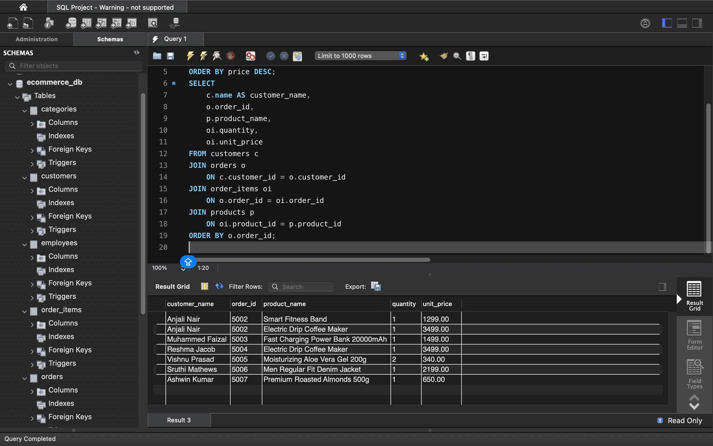
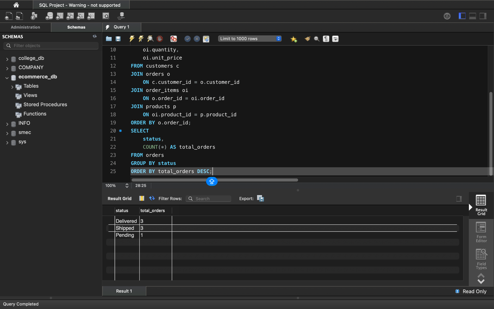

# E-Commerce Database Management System

## Project Overview
A relational database project developed using MySQL to manage the core operations of an e-commerce business. The database organizes customer, product, category, order, payment, and employee information.

## Technologies Used
- **Database:** MySQL
- **Tool:** MySQL Workbench
- **Language:** SQL

## Database Tables
The project contains seven tables:
- `customers`
- `categories`
- `products`
- `orders`
- `order_items`
- `payments`
- `employees`

## SQL Concepts Practiced
- Database and table creation
- Primary keys and foreign keys
- Data insertion and retrieval
- `UPDATE` and `DELETE` operations
- Filtering with `WHERE` and `LIKE`
- Sorting with `ORDER BY` and limiting results with `LIMIT`
- Aggregate functions such as `COUNT()`, `SUM()`, and `AVG()`
- Grouping with `GROUP BY` and filtering groups with `HAVING`
- Table relationships using `INNER JOIN` and `LEFT JOIN`
- Business-oriented queries and order analysis

## Project Screenshots

### Database Tables


### Product Records


### Multi-Table JOIN


### Order Status Analysis


## Repository Structure
```text
ecommerce-database-management-system/
├── ecommerce_db.sql
├── README.md
└── screenshots/
    ├── 01-database-tables.png
    ├── 02-product-records.png
    ├── 03-multi-table-join.png
    └── 04-order-analysis.png
```

## Learning Outcome
Practiced relational database design, SQL querying, joining related tables, and analyzing e-commerce data using MySQL.


